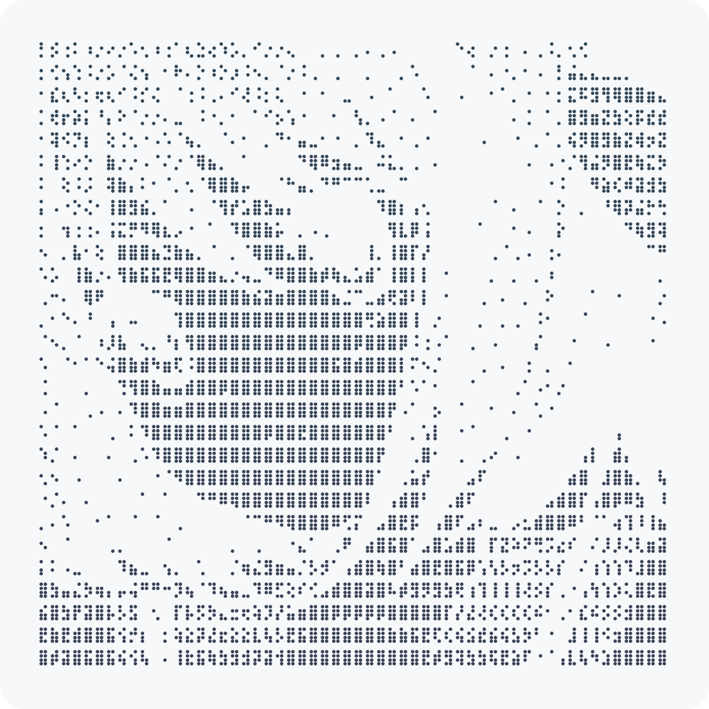

![Modern C++ template][github-sub-title:img]

<table align="center">
  <tr>
    <td width="50%" valign="top">
      <picture>
        <source media="(prefers-color-scheme: dark)" srcset="./assets/avatar-art-dark.png" />
        <source media="(prefers-color-scheme: light)" srcset="./assets/avatar-art-light.png" />
        
      </picture>
    </td>
    <td width="50%" valign="top">
      <!-- career-journey:start -->
      <picture>
        <source media="(prefers-reduced-motion: reduce)" srcset="./assets/career-journey-static.svg" />
        
      </picture>
      <!-- career-journey:end -->
    </td>
  </tr>
</table>

[github-sub-title:img]: https://readme-typing-svg.herokuapp.com?font=Segoe+Script&center=true&lines=Fl0rencess720.

